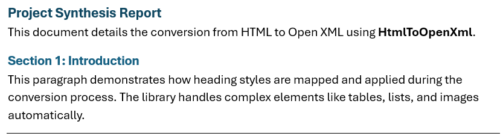

## Prerequisites

1. Create a new console application (.NET Core or .Net 6+ recommended).
2. Add a reference this NuGet package `dotnet add package HtmlToOpenXml`.

### Step 1: Define the source HTML

```csharp
const string htmlInput = @"
     <h1>Hello World!</h1>
     <p>This is the simplest example proving HtmlToOpenXml works.</p>";
```

### Step 2: The conversion process

```csharp
using DocumentFormat.OpenXml;
using DocumentFormat.OpenXml.Packaging;
using HtmlToOpenXml;
...

// 1. Create an in-memory stream to hold the resulting DOCX package data.
using (var generatedDocumentStream = new MemoryStream())
{
     // Initialize the DOCX package structure. This must happen before conversion.
     using (WordprocessingDocument document = WordDocumentFactory.Create(generatedDocumentStream))
     {
          // Initialize the Converter, binding it to the target document part.
          HtmlConverter converter = new HtmlConverter(document);

          // Perform the conversion into the document body.
          await converter.ParseBody(htmlInput);
     }

     // The stream must be rewound before being written to a file.
     generatedDocumentStream.Seek(0, SeekOrigin.Begin);
     File.WriteAllBytes(outputFilename, generatedDocumentStream.ToArray());

     Console.WriteLine($"Conversion successful. Output saved to: {outputFilename}");
}
```

Store your input markup in a string or resource file. For this example, we will use the Properties.Resources.
DemoHtml.html:

```html
<!DOCTYPE html>
<html>
<head>
    <meta charset="UTF-8">
    <title>Report Title</title>
</head>
<body>
    <h1>Project Synthesis Report</h1>
    <p>This document details the conversion from HTML to Open XML using <b>HtmlToOpenXml</b>.</p>
    <h2>Section 1: Introduction</h2>
    <p>This paragraph demonstrates how heading styles are mapped and applied during the conversion process. The library handles complex elements like tables, lists, and images automatically.</p>
    <hr/>
</body>
</html>
```

### Step 3: Visual generated output



## Page Orientation

Use the `PageOrientation` enumeration when creating a new document.

```csharp
using var document = WordDocumentFactory.Create(stream, PageOrientation.Landscape);
HtmlConverter converter = new HtmlConverter(document);
await converter.ParseBody(htmlInput);
```

## Using an existing template

HtmlToOpenXml can append content to an existing Word template while preserving its styles, themes,
numbering definitions, headers, footers, bookmarks and other document settings.

```csharp
await using var templateStream = File.OpenRead("template.docx");

await using var generatedDocument = new MemoryStream();
await templateStream.CopyToAsync(generatedDocument);
generatedDocument.Position = 0L;

using var package = WordprocessingDocument.Open(generatedDocument, true);
HtmlConverter converter = new(package);
await converter.ParseBody("""
     <h1>Project Report</h1>
     <p>This content uses the styles already defined in the template.</p>
""");
```

This approach is recommended when your organisation already maintains a Word template containing
corporate branding, custom styles, predefined headers, footers or document settings.
