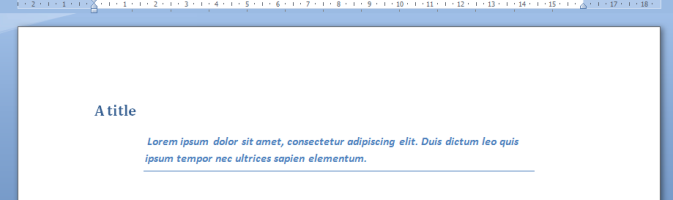

The `HtmlToOpenXml` converter serves as the bridge between the flexible structure of HTML and the rigorous object model of DOCX. The resulting fidelity depends on how you leverage the built-in style detection and mapping capabilities of the converter.

* **`style` attribute**: Used for applying specific, single-use formatting.
* **`class` attribute**: Used to apply reusable, named styles from the DOCX template.

## Style Detection and Reuse

The library automatically scans the target `WordprocessingDocument` document (especially when using a template) to detect and read existing styles. This allows the converter to intelligently reuse the document's established formatting, including themes.

## Auto-Mapping (Default Behavior)

For maximum efficiency, the converter recognizes common semantic tags (`<h1>`, `<table>`, `<p>`) and automatically applies default Word styles (e.g., `<h1>` → `Heading 1`). This is ideal when starting with a clean document.

**Predefined Styles Include:**

* Heading Levels (1–6)
* Caption, Footnote/Endnote, Quote Styles
* Hyperlink Styles
* Table Structure (e.g., TableGrid)

## Overriding Default Styles

You can override the default mapping for any tag by setting a specific style name via `converter.HtmlStyles.DefaultStyles`.

```csharp
// Example: Forcing all H1 tags to use a custom style instead of the default Heading 1.
converter.HtmlStyles.HeadingStyle = converter.HtmlStyles.GetStyle("CustomChapterTitle");
```

## Custom Mapping via Class Attribute

To override the default behavior or apply a unique style, use the `class` attribute. The converter uses this class name as the identifier it searches for in the target DOCX style definitions.

```html
<table class="Standard_Table TableWhite">...</table>
```

*The converter attempts to locate and apply styles matching the class names (`Standard_Table`, `TableWhite`), performing a runtime translation
between your HTML structure and the target DOCX.*

## OpenXml style mapping

You can assign an OpenXml style for all the paragraphs met during the conversion. Style attributes on the tag are still applied over the specified default style.

### Predefined Styles

When the converter encounters some tags (as `a` and `h1`) and the styles are missing from the Word document, the text is displayed in raw format, which doesn't give a nice visual feedback.
To circumvent this behavior, the converter will automatically insert the missing styles if needed.

* Caption
* Heading 1 to 6
* HyperLink
* TableGrid
* Footnote and Endnote
* Quote

You can override the predefined styles by specifying yourself the style name in `converter.HtmlStyles.DefaultStyles`.
In this example, the **Intense Quote** style is used.


```csharp
converter.HtmlStyles.DefaultStyle = converter.HtmlStyles.GetStyle("Intense Quote");
```

```html
<h1>A title</h1>
Lorem ipsum dolor sit amet, consectetur adipiscing elit.
Duis dictum leo quis ipsum tempor nec ultrices sapien elementum.
```

### CSS Class

If you wish to apply a specific style on an Html tag, you can use the native html `class` attribute.
Each time the converter encounters the `class` attribute, it looks for a Style in the Word document with the same name (case insensitive).
If it is not found, you can provide your own OpenXml style definition.

```html
<table class="Standard_Table TableWhite" cellspacing="0" cellpadding="0">
<thead>
    <tr>
    <td>Column 1</td>
    <td>Column 2</td>
</tr>
</table>
```

In this sample, the converter will try to find a style with the name **Standard_Table** and if not found, **TableWhite**.

### Advanced Workflow: Handling Missing Styles

If you add this line of code in the startup example and run it again, you will not see the "Heading 1" style applied.

```html
 <h1>First steps</h1>
```

In fact, the "Heading 1" style is well applied but this style does not exists in the document ; when you create a new document, no styles are defined : it's up to you. HtmlToOpenXml handles automatically the hyperlink style for you but it does not deal with every styles.
You can subscribe to the StyleMissing event to be warned and add them yourself.

Generally, you will load in memory an existing document template and append the Html conversion inside it. MS Word 2007 embeds a lot of informations (like styles, themes, document properties, ...) that you don't really want to bother with.

## Dynamic Style Provisioning

For scenarios where the required style does not exist in the target document, you can dynamically create and register it. This is crucial for building a robust converter that works seamlessly with any template.

The `StyleMissing` event provides the hook to handle this scenario:

```csharp
converter.HtmlStyles.StyleMissing += delegate(object sender, StyleEventArgs args)
{
    if (args.Name == "custom-style")
    {
        converter.HtmlStyles.AddStyle(new Style() {
            StyleId = "custom-style",
            Type = args.Type,
            BasedOn = new BasedOn { Val = "Normal" },
            StyleRunProperties = new() {
                Color = new() { Val = HtmlColorTranslator.FromHtml("red").ToHexString() }
            }
        });
    }
};
```

## Note on External CSS

`HtmlToOpenXml` handles standard inline HTML layouts and native **inline CSS** styles (e.g., `style="color: red;"`) out of the box with zero configuration.

By default, the converter **does not** process global stylesheets (`<link rel="stylesheet">`) or `<style>` block content. If your HTML template relies on classes and standalone CSS sheets, you must pre-process and inline the CSS into the HTML tags before conversion using one of these options:

### Option A: The First-Party Inliner (Recommended)

> An optimized pre-processing extension that automatically compiles and flattens global `<style>` declarations into native inline attributes using an asynchronous DOM pipeline.

Add our dedicated companion package to automate style compilation in a single, unified execution chain:

1. Add a reference this NuGet package `dotnet add package HtmlToOpenXml.CssInliner`.
2. Instantiate `CssStyleHtmlConverter`.

```csharp
var converter = new CssStyleHtmlConverter();
await converter.ParseHtmlAsync(mainPart, htmlWithStyleTags);
```

The `CssProcessing` property controls how stylesheets are resolved during conversion.

| Mode | Description | Use Case |
| :--- | :--- | :--- |
| `InternalOnly` | Processes only `<style>` elements embedded in the HTML document. | Network access is unavailable, HTML originates from untrusted sources or all required styles are already embedded in the document. |
| `All` (default) | Processes both the `<style>` elements and external stylesheets referenced through the `<link rel="stylesheet">` tag. | HTML relies on shared stylesheets or external CSS frameworks. Perform a network access, through `IWebRequest`. |

### Option B: Third-Party Pre-Processing (PreMailer.Net)

If you prefer a standalone utility or are already using **PreMailer.Net** in an email template workflow, you can explicitly move your CSS inline manually before parsing. The downside is the HTML is going to be parsed twice. This was the recommended option until v4.

```csharp
string html = ResourceHelper.GetString("Resources.CompleteRunTest.html");
string css = ResourceHelper.GetString("Resources.style.css");

// Compile separate CSS declarations straight into inline attributes
var result = PreMailer.Net.PreMailer.MoveCssInline(html, css: css);
html = result.Html;

HtmlConverter converter = new HtmlConverter(mainPart);
await converter.ParseHtml(html);
```
